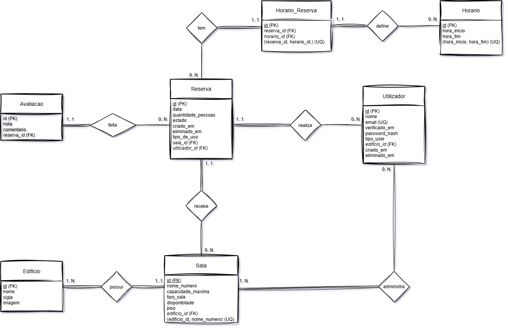

# 2024118083_2024116801-LAPRTP1

> **Projeto Prático de Desenvolvimento de Software em PHP**
> 
> *Laboratório de Programação Lado Servidor*
> 
> ***FEITO POR: Rayssa Santos e Tiago chousal***

---

# Tema: 
Site de uma biblioteca para fazer reservas de salas de estudo

---

# Descrição do domínio:
O portal resolve a superlotação dos espaços de estudo da Universidade Fernando Pessoa (UFP), permitindo **reservar salas de estudo com antecedência** e dando à universidade dados **reais de ocupação**.
O utilizador **consulta horários e aloca salas disponíveis**. Pode autenticar-se com a **conta institucional da UFP (ou conta pessoal, no caso de utilizadores externos),** o que permite traçar um perfil de utilização dos espaços: **preparação para exames**, **trabalhos de grupo ou leitura**.
Em qualquer modalidade, a reserva indica sempre o número de pessoas que vão ocupar a sala. Esta medida permite à UFP **analisar a taxa de ocupação**, **otimizar os espaços atuais** e **justificar a criação de novas salas**.

---

# Perfis do utilizador:
* **Utilizador** Default    
* **Admin** → Funcionário do edifício

---

# Lista preliminar de entidades:
* **Utilizador** → id, nome, email, password_hash, tipo (Estudante/Normal/Adm), biblioteca_id, criado_em, eliminado_em
* **Edificio** → id, nome,imagem
* **Horario** → id, hora_início, hora_fim, dia
* **Reserva** → id, sala_id, horario_id, utilizador_id, quantidade_pessoas, data, estado (confirmada/cancelada)
* **Sala** → id, nome_numero, capacidade_maximo, piso, biblioteca_id

---

# Requisitos Funcionais:

## Utilizador registado

* **RF1.** Consultar as salas disponíveis por edifício, capacidade e horário.
* **RF2.** Criar uma reserva, escolhendo sala, data, um ou mais horários seguidos, quantidade de pessoas e tipo de uso.
* **RF3.** Ver as plantas e fotos de cada edifício.

## Apenas utilizador registado

* **RF4.** Criar conta e iniciar sessão (conta institucional ou pessoal).
* **RF5.** Ver as suas próprias reservas.
* **RF6.** Cancelar as suas próprias reservas.
* **RF7.** Apagar a própria conta.

## Admin

* **RF8.** Criar, editar e apagar salas de estudo.
* **RF9.** Criar, editar e apagar horários.
* **RF10.** Criar, editar e apagar edifício(e as respetivas imagens).
* **RF11.** Ver e cancelar qualquer reserva, por exemplo quando a pessoa não aparece.
* **RF12.** O sistema deve disponibilizar uma área de administração (dashboard) exclusiva para o Admin gerir edifícios, horários e aprovar reservas.
* **RF13.** O funcionário deve aprovar ou rejeitar as reserva feitas pelo utilizador.
* **RF14.** Avaliar uma sala de estudo com uma nota e um comentário opcional.
* **RF15.** Filtrar e ordenar a lista de salas de estudo disponíveis com base na sua avaliação média.

---

# Requisitos não Funcionais:
* **RNF1.** Só o Admin pode editar ou apagar reservas e salas reservadas por outros; o utilizador comum gere apenas as suas reservas.
* **RNF2.** A interface de administração deve ser separada da interface do utilizador, com acessos diferenciados e verificados em cada pedido no servidor.
* **RNF3.** Proteção contra SQL injection e cross-site scripting em todas as queries (queries parametrizadas / prepared statements).
* **RNF4.** Passwords guardadas com hash (nunca em texto simples).
* **RNF5.** Cookies/sessão para manter o utilizador autenticado entre pedidos.
* **RNF6.** Quando uma conta é apagada, os dados pessoais são anonimizados e as reservas mantidas para fins estatísticos.

---

# Modelo E-R

---
# Dicionário de Dados

## Sala:
| Atributo | Chave | Descrição |
| --- | --- | --- |
| id | PK | Identificador da sala |
| nome_numero | | Nome ou número da sala |
| capacidade_maxima | | Capacidade total da sala |
| tipo_sala | | Identificador do tipo da sala (ex: laboratório, biblioteca...) |
| disponibilidade | | Disponibildade da sala (ex: disponível, ocupado, pedente) |
| piso | | Piso de onde a sala se encontra | 
| edificio_id | FK | Identificador do edifício que pertence |

## Utilizador:
| Atributo | Chave | Descrição |
| --- | --- | --- |
| id | PK | Identificador do utilizador |
| nome | | Nome do utilizador |
| email | UQ | Email do utilizador |
| password_hash | | Password em hash do utilizador |
| tipo_user | | Tipo do utilizador (se é admin, normal ou email da ufp) |
| edificio_id | FK | Identificador da sala administrada pelo admin |
| criado_em | | Data da criação da conta |
| eliminado_em | | Data da eliminação da conta |

## Reserva:
| Atributo | Chave | Descrição |
| --- | --- | --- |
| id |  | Identificador da reserva |
| data | | Data da reserva |
| quantidade_pessoas | | Quantidade de pessoas que foram adicionadas à reserva |
| estado | | Estado em que se encontra a reserva |
| criado_em | | Data da criação do pedido da reserva |
| tipo_de_uso | | Exame, Trabalho de grupo, Leitura ou Outro; preenchido por todos |
| sala_id | FK | Identificador da sala reservada |
| utilizador_id | FK | Identificador do utilizador que fez a reserva |

## Avaliação
| Atributo | Chave | Descrição |
| --- | --- | --- |
| id | PK | Identificador do edifício |
| nota | | Nome do edifício |
| comentário | | Comentário opcional sobre a reserva |
| id_reserva | FK | Identificador da reserva avaliada |

## Edifício
| Atributo | Chave | Descrição |
| --- | --- | --- |
| id | PK | Identificador do edifício |
| nome | | Nome do edifício |
| sigla | | Sigla que identifica o edifício |
| imagem | | Planta do edifício |

## Horário
| Atributo | Chave | Descrição |
| --- | --- | --- |
| id | PK | Identificador do horáro |
| hora_inicio | | Hora do início do horário |
| hora_fim | | Hora do fim do horário |

---

# Regras de Negócio e restrições de Integridade
* **Ciclo de Vida e Gestão de Conflitos.** Quando um utilizador solicita uma reserva, esta é criada com o estado ‘*pendente*’. A transição para o estado ‘*confirmada*’ ou ‘*rejeitada*’ depende de validação manual do Admin. No momento da confirmação, o sistema garante que não existem sobreposições iniciando uma transação com bloqueio de linhas (FOR UPDATE): verifica-se via JOIN com a tabela *ReservaHorario* se algum dos horários solicitados já se encontra associado a uma reserva '*confirmada*' para a mesma sala e data, rejeitando a operação em caso de conflito. 
* **Capacidade.** *quantidade_pessoas* tem de estar entre 1 e *capacidade_maxima* da sala escolhida.
* **Registado.** Cada reserva tem *utilizador_id* preenchido (registado).
* **Admin e edifício.** *Utilizador.edificio_id* só é preenchido quando *tipo = Adm*, e esse Admin só gere salas, horários e reservas do seu edifício.
* **Datas.** Não se pode reservar no passado, e *hora_fim* é sempre maior que *hora_inicio*.
* **Cancelamento.** O utilizador registado só cancela reservas suas; o Admin cancela qualquer reserva do seu edifício.
* **Apagar conta.** Em vez de apagar a linha, anonimizam-se nome e email, preenche-se *eliminado_em* e mantêm-se as reservas para as estatísticas de ocupação.
* **Unicidade.** *Utilizador.email*.
* **Vários horários seguidos.** Cada reserva ocupa um ou mais slots consecutivos, sem intervalos, todos do mesmo dia e da mesma sala, registados em ReservaHorario.
* **Veracidade das Avaliações.** Um utilizador só pode avaliar uma sala através de uma reserva sua, e apenas se essa reserva tiver sido efetivamente utilizada.
* **Avaliação Única.** Cada reserva só pode gerar, no máximo, uma avaliação no sistema.

