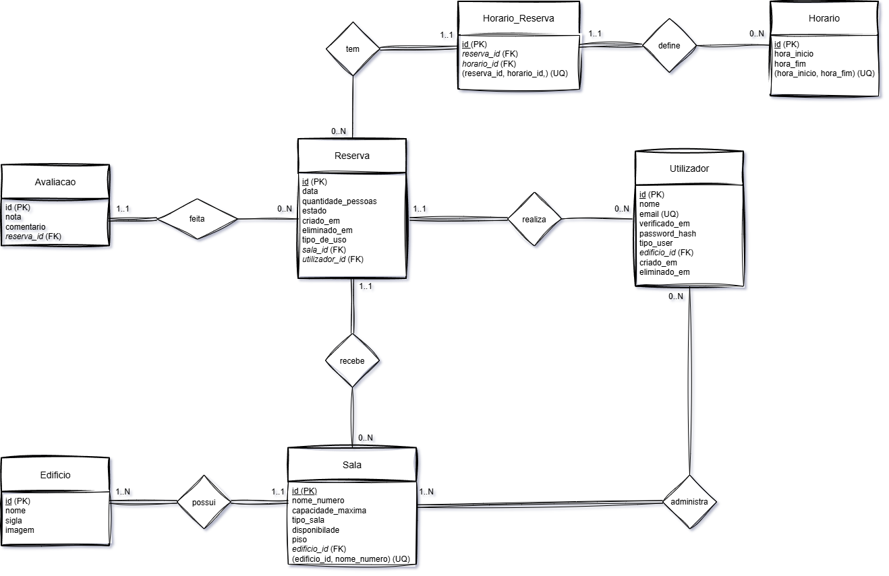

# 📚 Reserva de Salas — UFP


> **Projeto Prático de Desenvolvimento de Software em PHP**  
> *Laboratório de Programação Lado Servidor (LAPRTP1)* — Universidade Fernando Pessoa (UFP)  
> **Autores:** Rayssa Santos (`2024118083`) e Tiago Chousal (`2024116801`)

---

## 🎯 Tema

Portal web da **Universidade Fernando Pessoa** para consulta e reserva de salas.

---

## 📖 Descrição do Domínio

O portal tem como objetivo resolver a superlotação dos espaços de estudo da Universidade Fernando Pessoa (UFP), permitindo **reservar salas de estudo com antecedência** e fornecendo à universidade **dados reais de ocupação**.

Através da plataforma, os utilizadores podem **consultar horários e alocar salas disponíveis**, autenticando-se com a **conta institucional da UFP**. Este registo permite traçar o perfil de utilização dos espaços, nomeadamente:
- Preparação para exames;
- Trabalhos de grupo;
- Leitura / estudo individual.

Em qualquer reserva é indicado o número de pessoas que irão ocupar a sala, permitindo à UFP **analisar a taxa de ocupação**, **otimizar os espaços existentes** e **justificar a criação de novas salas**.

---

## 🛠️ Tecnologias Utilizadas

- **Back-end:** PHP / Laravel
- **Front-end:** Blade Templates + Vite (Node.js / npm)
- **Testes:** PHPUnit (`phpunit.xml`)
- **Base de Dados:** Relacional (gerida via *Migrations* do Laravel)

---

## 👥 Perfis de Utilizador

- **Utilizador (Default):** Estudante (conta institucional UFP).
- **Admin:** Funcionário responsável pela gestão dos edifícios, salas, horários e reservas.

---

## ✅ Requisitos Funcionais

### Consulta e Reservas (Utilizador)
- **RF1.** Consultar as salas disponíveis por edifício, capacidade e horário.
- **RF2.** Criar uma reserva, escolhendo sala, data, um ou mais horários seguidos, quantidade de pessoas e tipo de uso.
- **RF3.** Ver as plantas e fotos de cada edifício.
- **RF4.** Iniciar sessão (conta institucional).
- **RF5.** Ver as suas próprias reservas.
- **RF6.** Cancelar as suas próprias reservas.
- **RF13.** Avaliar uma sala de estudo com uma nota e um comentário opcional.
- **RF14.** Filtrar e ordenar a lista de salas de estudo disponíveis.

### Administração (Admin)
- **RF7.** Criar, editar e apagar salas.
- **RF8.** Criar, editar e apagar horários.
- **RF9.** Criar, editar e apagar edifícios (e as respetivas imagens).
- **RF10.** Ver e cancelar qualquer reserva (por exemplo, em caso de não comparência).
- **RF11.** Apagar cometários ofensivos.
- **RF12.** Aprovar ou rejeitar as reservas efetuadas pelos utilizadores.

---

## 🔒 Requisitos Não Funcionais

- **RNF1.** Apenas o Admin pode editar ou apagar reservas e salas reservadas por outros utilizadores; o utilizador comum gere apenas as suas próprias reservas.
- **RNF2.** A interface de administração deve ser separada da interface do utilizador, com controlo de acessos verificado no servidor em cada pedido.
- **RNF3.** Proteção contra *SQL Injection* e *Cross-Site Scripting (XSS)* (utilização do ORM Eloquent / *prepared statements* e escape automático nas *views* Blade).
- **RNF4.** Palavras-passe armazenadas com *hash* seguro (nunca em texto simples).
- **RNF5.** Gestão de sessão/cookies para manter o utilizador autenticado entre pedidos.
- **RNF6.** Quando uma conta é eliminada, os dados pessoais são anonimizados e o histórico de reservas é mantido para fins estatísticos.

---

## 🗂️ Estrutura do Projeto

```text
├── app/              # Lógica da aplicação (Models, Controllers, Middleware, etc.)
├── apresentacao/     # Materiais de apresentação e diagramas (Modelo E-R)
├── bootstrap/        # Inicialização da framework Laravel
├── config/           # Ficheiros de configuração da aplicação
├── database/         # Migrations, Seeders e Factories
├── public/           # Ponto de entrada público (index.php e assets compilados)
├── resources/        # Views (Blade), CSS e JavaScript
├── routes/           # Definição de rotas web e API
├── storage/          # Logs, cache e ficheiros carregados
├── tests/            # Testes automatizados (PHPUnit)
├── .env.example      # Exemplo de variáveis de ambiente
├── artisan           # CLI do Laravel
├── composer.json     # Dependências PHP
├── package.json      # Dependências Front-end
└── vite.config.js    # Configuração do Vite
```

---

## 🗄️ Modelo Entidade-Relacionamento (E-R)



---

## 📊 Dicionário de Dados

### `Sala`
| Atributo | Chave | Descrição |
| :--- | :---: | :--- |
| `id` | PK | Identificador único da sala |
| `nome_numero` | | Nome ou número da sala |
| `capacidade_maxima` | | Capacidade máxima de ocupantes da sala |
| `tipo_sala` | | Tipo da sala (ex.: laboratório, biblioteca, sala de grupo) |
| `disponibilidade` | | Estado de disponibilidade da sala (ex.: disponível, ocupada, pendente) |
| `piso` | | Piso onde a sala se encontra |
| `edificio_id` | FK | Identificador do edifício ao qual a sala pertence |

### `Utilizador`
| Atributo | Chave | Descrição |
| :--- | :---: | :--- |
| `id` | PK | Identificador único do utilizador |
| `nome` | | Nome do utilizador |
| `email` | UQ | Endereço de email do utilizador |
| `password_hash` | | Palavra-passe armazenada em *hash* |
| `tipo_user` | | Tipo de utilizador (`admin`, `normal` ou conta institucional UFP) |
| `criado_em` | | Data de criação da conta |
| `eliminado_em` | | Data de eliminação/anonimização da conta (*soft delete*) |

### `Edificio`
| Atributo | Chave | Descrição |
| :--- | :---: | :--- |
| `id` | PK | Identificador único do edifício |
| `nome` | | Nome do edifício |
| `imagem` | | Caminho/URL da imagem ou planta do edifício |

### `Horario`
| Atributo | Chave | Descrição |
| :--- | :---: | :--- |
| `id` | PK | Identificador único do horário |
| `hora_inicio` | | Hora de início do bloco horário |
| `hora_fim` | | Hora de fim do bloco horário |
| `dia` | | Dia associado ao horário |

### `Reserva`
| Atributo | Chave | Descrição |
| :--- | :---: | :--- |
| `id` | PK | Identificador único da reserva |
| `sala_id` | FK | Identificador da sala reservada |
| `horario_id` | FK | Identificador do horário reservado |
| `utilizador_id` | FK | Identificador do utilizador que realizou a reserva |
| `quantidade_pessoas` | | Número de pessoas que vão ocupar a sala |
| `data` | | Data da reserva |
| `estado` | | Estado da reserva (ex.: pendente, confirmada, cancelada, rejeitada) |

---

## 🚀 Instalação e Execução Local

### Pré-requisitos
- **PHP** (recomendado >= 8.2) e **Composer**
- **Node.js** e **npm**
- Base de dados configurada (SQLite, MySQL ou PostgreSQL, conforme `.env.example`)

### Passos

1. **Clonar o repositório:**
   ```bash
   git clone https://github.com/TiagoCC23/2024118083_2024116801-LAPRTP1.git
   cd 2024118083_2024116801-LAPRTP1
   ```

2. **Instalar as dependências PHP e JavaScript:**
   ```bash
   composer install
   npm install
   ```

3. **Configurar as variáveis de ambiente:**
   ```bash
   cp .env.example .env
   php artisan key:generate
   ```
   Edita o ficheiro `.env` com os dados da tua base de dados.

4. **Executar as migrações (e *seeders*, se aplicável):**
   ```bash
   php artisan migrate
   # ou com dados iniciais:
   # php artisan migrate --seed
   ```

5. **Criar a ligação simbólica para o *storage* (para imagens de edifícios/salas):**
   ```bash
   php artisan storage:link
   ```

6. **Iniciar os servidores de desenvolvimento:**
   ```bash
   # Terminal 1 — Servidor Laravel
   php artisan serve

   # Terminal 2 — Compilação de assets com Vite
   npm run dev
   ```

A aplicação ficará disponível por defeito em `http://127.0.0.1:8000`.

---

## 🧪 Executar Testes

Para correr a suite de testes configurada no projeto:

```bash
php artisan test
```
